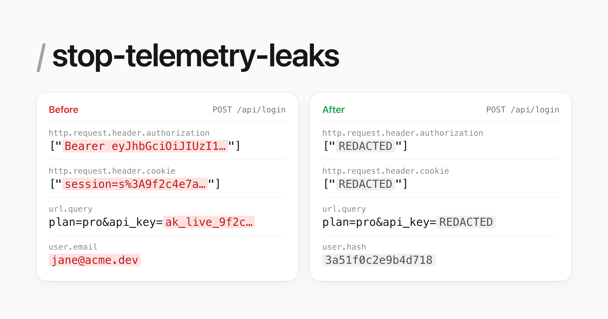

# stop-telemetry-leaks

[](https://skills.sh/pjsny/stop-telemetry-leaks)

Your observability vendor is part of your attack surface. If your OpenTelemetry spans carry PII and API keys, every breach of that vendor carries them too.

This skill finds those leaks and fixes them. If you want proof, it can also send fake secrets through your app and check what your exporters would send.

```sh
npx skills add pjsny/stop-telemetry-leaks
```

Then run `/stop-telemetry-leaks` in your repo. That's it.

## What it catches

The same handful of mistakes, over and over:

| Leak | Where it hides | Fix |
|---|---|---|
| Bearer tokens and cookies on every span | `headersToSpanAttributes`, `OTEL_INSTRUMENTATION_HTTP_CAPTURE_HEADERS_*` | Stop capturing them |
| `?api_key=` in exported URLs | `redactedQueryParams: ['token']` quietly drops the defaults and only covers outgoing requests | One merged list, both directions |
| Passwords in log lines | `logger.info("login %s password=%s", ...)` | Log the user, not the password |
| Request bodies in exceptions | `` new Error(`rejected: ${JSON.stringify(req.body)}`) `` | Fixed message, context in attributes |
| Exporter keys in git | `OTEL_EXPORTER_OTLP_HEADERS=api-key=...` in `.env` | Env reference, then rotate the key |
| Card fields in session replays | `maskAllInputs: false`, rrweb defaults, Datadog `'allow'` | Mask inputs globally |

Credential leaks get fixed right away. Anything that changes user data, like hashing emails, comes back as a proposed diff so you can check your dashboards first.

It covers OpenTelemetry in Python and Node, plus 20 session replay tools: Interfere, Sentry, Datadog, PostHog, rrweb, LogRocket, FullStory, Clarity, Hotjar, Amplitude, Mixpanel, New Relic and more. Before touching a recorder, it reads the privacy docs for the version you have installed.

## Does it work

Same agent, same task, with and without the skill, on four apps with planted leaks. Then fake secrets the agent never saw go through each result.

| App | Untouched | Without skill | With skill |
|---|---:|---:|---:|
| FastAPI | 24 | 9 | **2** |
| Express | 38 | 2 | **0** |
| Fastify | 20 | 12 | **0** |
| Session replay app, critical leaks fixed | | 2 of 7 | **7 of 7** |

The 2 left on FastAPI were a token inside an exception message. The agent proposed that fix instead of applying it. One run each, so treat this as a sanity check, not a benchmark. These runs used the version where fake-secret verification always ran; it's now opt-in, and the static-only default hasn't been rerun yet. Method and grading files are in [evals/](evals/).

## How it works

It's plain Markdown. No scripts, no MCP server.

1. Asks once whether you want a verification run. The default is no, because it's the slow part.
2. Greps for the places leaks usually live and reads the config, including the privacy docs for your replay SDK's version.
3. Fixes what it found, one commit per fix, and runs your tests.
4. Writes `otel-pii-report.md`, including any committed secrets you need to rotate.

If you say yes to verification, it sends fake secrets through your app before and after the fixes, using either an in-memory exporter in a temporary test or a throwaway local Collector (Docker). Fixed means none come through. Nothing reaches your vendor.

## Found a leak with it?

[Open an issue](https://github.com/pjsny/stop-telemetry-leaks/issues/new) and tell me what it caught. No secrets in the issue, obviously.

## License

MIT
